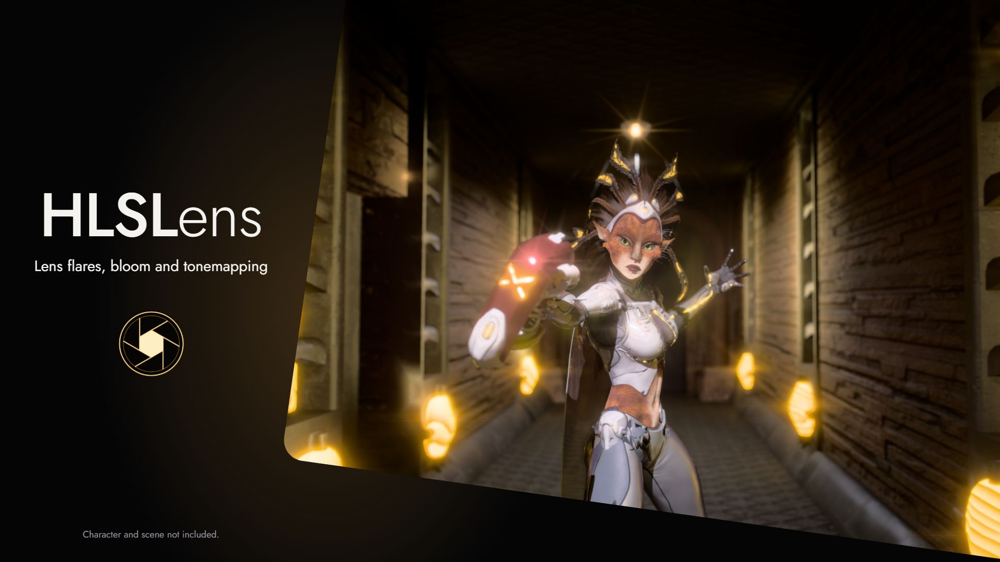
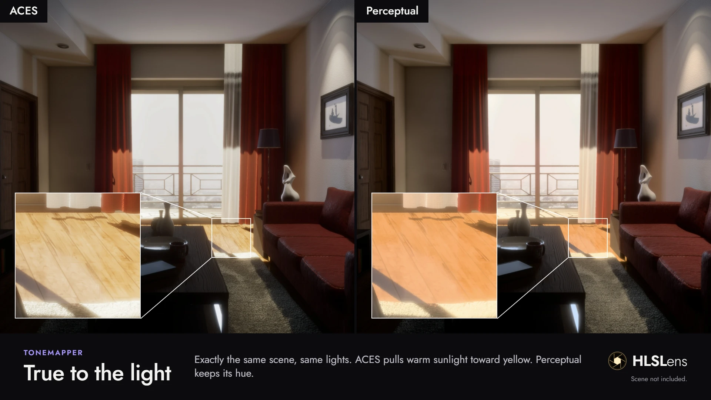

<h1 class="visually-hidden">HLSLens</h1>

HLSLens is a post-processing plugin for <strong>Unreal Engine 5</strong>. It adds an <strong>Advanced Post Process Volume</strong> and replaces parts of the engine's post-processing with custom effects written in HLSL. No engine files are deleted or modified.

<!-- TODO: replace the Fab link with your product page -->
[Get started](installation.md){ .md-button .md-button--primary }
[View on Fab](https://www.fab.com/){ .md-button }

## Up and running in three steps

1
**Install the plugin**

From Fab, or by copying it into your project's `Plugins` folder. [Installation guide](installation.md)

2
**Add the volume**

Place an Advanced Post Process Volume in your level. Every effect reads its settings from it.

3
**Tune the look**

Everything lives in the volume's Details panel, like the engine's own volume. No `.ini` files or console variables.

<figure markdown="span">
  
</figure>

## Effects

<a href="lens-flares/">
  Lens flares
  Procedural ghosts, halo, streak and glare, built from the bright pixels in your scene. Five lens presets included.
  Read →
</a>
<a href="bloom/">
  Bloom
  A Kawase-blur bloom that fades smoothly, without the rings the engine's bloom can show in its falloff.
  Read →
</a>
<a href="halation/">
  Halation
  The red-orange glow film shows around very bright lights. Almost free, because it reuses the bloom.
  Read →
</a>

### Also in the plugin

<ul class="also">
<li><strong>Tonemapper</strong> The engine's ACES, or the HLSLens Perceptual tonemapper, which keeps emissive lights closer to their true color. Brightness and hue controls for 12 color channels.</li>
<li><strong>Chromatic aberration</strong> A Basic mode and a Dynamic Blurring mode with depth-based intensity, custom spectral colors and fringe blur.</li>
<li><strong>Film grain</strong> Procedural or texture-based grain with optional chromatic grain.</li>
<li><strong>Lens distortion</strong> Barrel and pincushion distortion.</li>
<li><strong>Vignette and damage indicators</strong> A vignette with shape and falloff controls, plus a directional damage indicator driven by a world-space hit location (singleplayer only).</li>
<li><strong>LUT blending</strong> Blend LUTs and color-correction settings by scene depth, a custom mask or time of day.</li>
<li><strong>Debug tools</strong> On-screen overlays for the Perceptual tonemapper curve and for time-of-day blending.</li>
</ul>

## Good to know

!!! warning "A volume is required"
    Without an Advanced Post Process Volume in your level, the custom effects have nothing to read their settings from.

- **Most optional effects are off by default.** Film Grain, Chromatic Aberration and Lens Distortion start at intensity `0.0`.
- **The Perceptual tonemapper changes your look.** It shows emissive colors more accurately, so you will likely need to adjust some light colors. ACES remains available and works with all HLSLens effects.
- **Performance.** HLSLens costs slightly more GPU time than the engine's default post-processing. See the Performance section for results.
- **Some features are left untouched.** Motion blur, depth of field, anti-aliasing, global illumination and reflections work the same with HLSLens as they do with the engine's post-processing.
