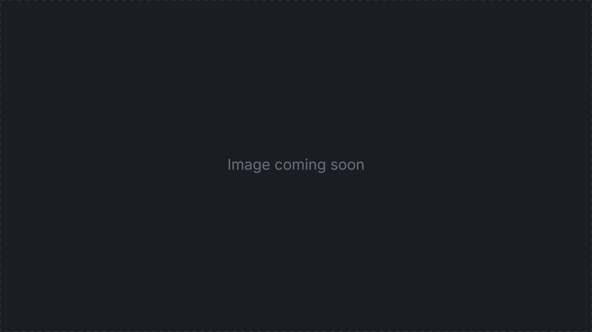

# Quick Start

Get a working result in a few steps.

## 1. Add the component

Open your level, select an actor and add the **My Plugin Component** in the *Details* panel.

{ width="600" }

## 2. Tweak a setting

```cpp
// Example: change a setting from C++
MyComponent->SetIntensity(0.75f);
```

## 3. Press Play

You should now see the effect in the viewport.

!!! tip
    Short GIFs of the effect work great here. Drop them into `docs/assets/`.
